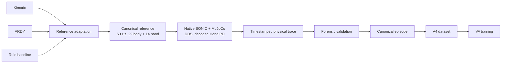
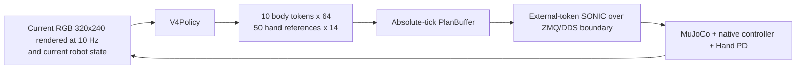

# Group2 Humanoid Robotics Research: Technical Architecture and Reproducibility Report

Date: 2026-10-16  
Environment for validated native work: `va-train`, Python 3.10.12, PyTorch 2.9.0, `torch_musa 2.9.0+8432052`, eight MTT S4000 devices, MUSA SDK 4.3.6.

This report describes the repository as it exists after consolidation. It uses three evidence labels:

- **VERIFIED** — supported by maintained source code, a present artifact, a recorded hash, or an execution log that was inspected.
- **REPORTED** — stated by a historical report or handoff whose complete primary run bundle is not present in the current evidence set.
- **NOT VERIFIED** — not established by the available files or by the checks performed here.

The workspace contains several preserved Git repositories (`dl-group2`, `GR00T-WholeBodyControl`, `va_training`, and `kimodo-t6/soma-x`) plus maintained source directories at the workspace root. It is not represented as one Git repository. This distinction matters when reproducing a run: the run manifest, source hashes, external checkout, container image, and hardware profile together define the executable environment.

## A. Project overview and motivation

The project began as a whole-body humanoid motion and grasping study. The first problem was to turn text-conditioned motion models and deterministic expert policies into G1 body and hand references that a fixed SONIC controller could execute in a MuJoCo tabletop scene. Kimodo and ARDY provide learned motion generation; a rule-based producer provides a controlled baseline. Their outputs require producer-specific adaptation, timing, hand scheduling, and qualification before they can cross the shared reference boundary.

The second problem was data production. A successful-looking trajectory is insufficient for learning: the reference, native SONIC execution, MuJoCo state, RGB observation, controller tokens, hand reference, tick identities, and validation decisions must agree. The Canonical Data Factory therefore preserves an execution trace and performs forensic joins before serializing training samples.

The third problem was visuomotor learning. VA models learn to predict SONIC-compatible body tokens and hand references from current RGB and robot state. The learned policy is evaluated at several independent gates: canonical dataset validity, offline prediction quality, runtime scheduling integrity, and physical grasp success. A pass at one gate does not imply a pass at the next.

The scope is a right-hand tabletop grasp/lift/hold task unless an artifact explicitly records another arm. The repository does not establish general manipulation competence, sim-to-real transfer, or statistical equivalence between model families. It preserves failed runs and does not relax physical thresholds to make them pass.

## B. End-to-end architecture

The maintained seven-area structure is:

```text
research/kimodo       research/ardy       rule producer in dl-group2
        \                    |                    /
         \                   |                   /
          +--> canonical reference (contracts/) -+
                                |
                native SONIC + MuJoCo + Hand PD
                                |
              trace + forensic validation (data_factory/)
                                |
             canonical episode / V4 dataset tensors
                                |
                    VA training and checkpoint
                                |
                 offline evaluation and gate
                                |
                    VA closed-loop inference
                                |
              RGB + robot state -> VA -> SONIC
```

The expert-data path is deliberately one-way at each boundary:



The online path closes the loop without feeding expert future actions to the policy:



The diagrams describe interfaces implemented in `contracts/`, `data_factory/`, `va_research/models/v4/`, and `va_research/sonic/`; they do not imply that every historical script uses the unified runner.

## C. Research modules and ownership

### C.1 Kimodo

Authoritative maintained code is under [research/kimodo](../research/kimodo/). `research/kimodo/workflow.py:build_commands` constructs the task, generation, export, and qualification stages used by `python -m experiments run --family kimodo`. The generator in `generation/generate_grasp_motion.py` loads the frozen local Kimodo checkpoint and text encoder, validates the 487-frame/30 Hz task, records task hashes, and writes raw motion plus generation metadata. The exporter in `export/export_kimodo_reference.py`:

1. verifies task and generation identity and raw-motion hashes;
2. resamples 30 Hz qpos to an authored 50 Hz timeline using linear interpolation for scalar coordinates and quaternion SLERP;
3. converts the source to the canonical 29-DoF body and 14-DoF hand order;
4. applies the declared neutral-world-wrist adaptation and optional bounded contact/approach refinement;
5. applies only explicitly supplied offline tracking calibration;
6. refuses a candidate when the offline IK target error exceeds 0.02 m or correction bounds are exceeded.

The qualification stage replays the candidate through the existing SONIC/MuJoCo path and records physical metrics. The maintained code preserves the frozen adapter configuration and does not change the acceptance criterion.

**VERIFIED:** command construction, local checkpoint configuration, source-hash checks, reference validation, and the refusal path are present in the maintained source. The current final audit records a real Kimodo generation that produced 487 frames but was refused by the existing IK gate, with measured error about 6.99 m. The complete fresh generation is therefore not a passing reproduction.

**REPORTED:** the October 8 fixed-center comparison summary reports 19/20 physical and 19/20 validated Kimodo successes. The current workspace does not contain the complete comparison run bundle sufficient to independently re-execute those 20 seeds, so the summary is historical evidence rather than a fresh result.

### C.2 ARDY

Authoritative maintained code is under [research/ardy](../research/ardy/). The pipeline in `qualification/run_pipeline.py` records a config snapshot, code snapshot, stage logs, environment, and explicit `raw_motion_reused`/`other_workspaces_modified` flags. Its ordered stages are preparation, segmented generation, adaptation, isolated replay, and verification. The ARDY model checkout and checkpoints remain the external dependency at `workspace/fuyuhan/ardy`; `research/ardy/online/qwen/qwen_ardy` is a separate online research path.

The generator uses ARDY's 25 Hz model and five segments with transition history/overlap. The maintained configuration requires five segment lengths `[100, 100, 50, 50, 106]`, five transition frames, and complete 16.2-second coverage. The adapter in `adaptation/adapt_ardy.py` resamples 25 Hz motion to the authored 50 Hz timeline, uses quaternion SLERP, projects the wrist toward the planned task-space corridor, performs bounded offline IK, applies the independently timed hand schedule, and rejects excessive correction or error. Calibration is optional but must carry hashes for its evidence files.

**VERIFIED:** the maintained pipeline, its path resolution, and the recorded ARDY canonical artifact at `outputs/canonical_va/diverse_block_xy_20/attempts/ardy_near_seed2/unified_native_episode/` are present. The final audit reports an isolated 810/810-tick replay with no missing ticks or foreign processes and valid forensic integrity. The physical grasp result for the relevant ARDY run is false; runtime integrity and physical task success are reported separately.

**REPORTED:** the October 8 historical comparison summary reports 20/20 physical and 19/20 validated ARDY successes. This report does not treat that summary as a current fresh-generation result.

### C.3 Rule-based expert baseline

Rule-based trajectory production remains in the preserved `dl-group2` repository because it is coupled to the frozen scene and controller scripts. Its source is not a second maintained implementation of Kimodo or ARDY. The representative catalog is [expert_datasets/rule_reference_right100_v3/manifest.json](../expert_datasets/rule_reference_right100_v3/manifest.json), with selection and production evidence under `outputs/rule_reference_right100_v3_remaining_0002/` and related versioned output roots.

The baseline produces explicit hand profiles, approach/closure timing, calibrated references, physical metrics, and source hashes. A rule reference is accepted only after the same canonical trace and validation boundary used by learned experts. The rule catalog contains lift and hold measurements per episode; its records are evidence of the baseline production protocol, not a claim that every duplicate manifest is an independent run.

### C.4 Canonical reference contracts

[contracts/reference.py](../contracts/reference.py), `execution/sonic_mujoco/schema.py`, and `data_factory/runtime/schema.py` define the boundary. `CanonicalReference.validate` requires:

- `time_s` beginning at zero with strictly increasing 0.02-second spacing;
- 29 body joint positions and velocities;
- 3D world root position and unit `wxyz` root quaternion;
- 14 hand positions and optional 14 hand velocities;
- SI units (`rad`, `rad/s`, `m`, seconds), world root frame, and explicit producer type (`kimodo`, `ardy`, or `rule_based`);
- zero initial hand reference;
- finite values and matching array lengths.

The native schema validator additionally checks body and hand names against the protected SONIC joint-order source, required metadata/provenance files, reference completeness, case identity, and source validation flags. It does not infer target offsets from matching array indices.

### C.5 SONIC, MuJoCo, DDS, Hand PD, and rendering

Protected SONIC source remains in [GR00T-WholeBodyControl](../GR00T-WholeBodyControl); the frozen tabletop/controller dependency is in [dl-group2](../dl-group2). Maintained adapters are in [execution/sonic_mujoco](../execution/sonic_mujoco) and [va_research/sonic](../va_research/sonic).

The release bundle is checked by `va_research/sonic/release.py`. Its encoder contract is `[1,1762] -> [1,64]`; its decoder contract is `[1,994] -> [1,29]`; the observation configuration requires the release full-base-orientation mode and 64-dimensional token output. VA closed loop sends external 64-dimensional tokens to the native SONIC process; the native process owns decoder history, controller arithmetic, and the original Hand PD path. `ExternalTokenAdapter.message` packs a version-4 pose message with an authored absolute frame index.

The canonical runtime uses isolated network namespaces for DDS. The native controller runs at 200 Hz physics with 50 Hz control, and the native publisher path is recorded at 500 Hz. The canonical RGB camera is `head_rgb`, 320x240, 10 Hz in the recorded runtime provenance. Hand PD remains a separate 14-DoF controller with the recorded gain contract; learned hand targets are timestamped and applied through `TimestampedHand`.

`execution/sonic_mujoco/rendering.py` and `canonical_va/rendering.py` bootstrap the validated EGL profile. Production mode rejects software rendering. The verified profile reports `GL_VENDOR=Moore Threads` and `GL_RENDERER=MTT S4000`.

### C.6 Canonical Data Factory

The maintained factory is split between [data_factory/runtime](../data_factory/runtime) and [data_factory/dataset](../data_factory/dataset). The runtime compiler/replay path preserves native traces, source references, controller observations, tokens, hand references, physical states, contact results, and tick identities. Forensic validation joins records by authored timestamps and IDs; it does not repair missing frames by index or synthesize future labels.

`data_factory/dataset/dataset.py` reads only accepted canonical episodes, verifies the complete retained fields, checks sample IDs and contiguous target IDs, verifies RGB/state/token/reference identities, and drops only tails that cannot provide the requested horizon. It records source hashes, split IDs, sample ranges, and canonical provenance. The V4 dataset stores RGB, 68-dimensional body state, 28-dimensional hand state, 10x64 body-token targets, 50x14 hand-reference targets, phase, and progress.

**VERIFIED representative:** `outputs/canonical_va/kimodo_19_merged/training_manifest.json` names 19 source episodes, explicitly excludes `kimodo_episode_0015`, and records 3,059 samples. The referenced source sample files and merged `va_dataset/samples.npz` exist after `/workspace/group2` path normalization. This is a valid data artifact; it is not evidence that all 20 comparison episodes were accepted.

### C.7 VA research

The registry in [va_research/registry.py](../va_research/registry.py) distinguishes V2, V3, V4, BCZ-hand, V4.1, and oracle families. Current unified executable workflows target V4 and BCZ-hand; V2/V3 and coupled legacy scripts remain compatibility/history.

The V4 implementation is in [va_research/models/v4](../va_research/models/v4). `V4Policy` receives current RGB `[B,3,128,128]`, body state `[B,68]`, and hand state `[B,28]`. Four stride-2 convolution blocks produce 256-channel visual features. Separate body and grasp queries use four-head cross-attention over 64 visual positions. The body head emits `10 x 64` body tokens; the hand head emits `50 x 14` hand references; phase classification has three classes and closure progress is a sigmoid scalar.

The objective in `v4/losses.py` is a weighted sum of smooth-L1 body-token loss, MSE hand-reference loss, cross-entropy phase loss, and MSE progress loss. Training in `v4/training.py` uses train-only state normalization with standard deviation clamped at 0.05, AdamW, gradient clipping at 10, seeded shuffling, and the configured offline gate. `v4/evaluation.py` computes token MAE/MSE, FSQ scalar accuracy, whole-token exact accuracy, hand MAE, phase accuracy, and progress MAE, then checks the saved gate.

The release FSQ representation has 32 scalar levels, represented by `(-16 ... 15)/16` after rounding/clamping. V4 evaluation computes this post-FSQ scalar accuracy from the predicted 64-dimensional body token values. It does not silently replace the native SONIC token semantics.

The closed-loop scheduler in `v4/runtime.py` is absolute-tick based. `PlanBuffer.add` accepts a 10-slot body plan and 50-slot hand plan, requires successive plan starts exactly five ticks apart, and records deadline misses. `PlanBuffer.take` requires each consumed tick to be exactly the next absolute tick and fails on uncovered, repeated, or skipped ticks. This is why a completed runtime can report zero uncovered ticks and zero deadline misses independently of its physical lift result.

### C.8 Experiment orchestration and artifact indexing

[experiments](../experiments) is the primary command surface. `experiments/workflows.py` builds commands; `experiments/execute.py:execute_stages` creates immutable output directories, captures stage logs, records Python/environment provenance, and writes `run_manifest.json`; `experiments/catalog.py` indexes persistent manifests and evidence files.

The catalog currently contains 205 manifest entries, 1,208 hashed evidence files, 175 canonical episode manifests, 12 compiled-dataset manifests, one expert-reference catalog, five training-checkpoint manifests, and 11 intermediate experiment manifests. It records 195 duplicate episode-identity groups. Fourteen intermediate or legacy manifests are explicitly marked incomplete. These counts are discovery metadata, not counts of independent successful experiments.

## D. Technical interfaces and timing

### Reference and controller dimensions

The canonical body reference is 29 joints; the independent hand reference is 14 joints. Root position and quaternion are carried separately. SONIC's release decoder maps the 994-dimensional decoder input to 29 body outputs, while the external policy hand reference is applied through the preserved Hand PD path. The release encoder emits 64-dimensional post-FSQ tokens. A V4 body plan therefore contains ten 64-dimensional token vectors, and a hand plan contains fifty 14-dimensional vectors.

### Absolute timing

The canonical reference timeline is 50 Hz: tick `k` means authored time `k/50` seconds. An 810-frame episode spans timestamps 0 through 16.18 seconds and represents a 16.2-second execution horizon. SONIC physics advances at 200 Hz, with four physics steps per 50 Hz control tick. The native publisher path is 500 Hz. RGB is recorded at 10 Hz in the validated runtime provenance. The VA scheduler replans every five control ticks and predicts ten body-token slots (0.2 seconds of 50 Hz body tokens) plus a longer hand-reference horizon.

The runtime does not match arrays by position alone. Native logs carry frame/tick IDs; canonical sample mappings carry `sample_id`, `observation_id`, `token_id`, and `hand_ref_id`; V4 loading verifies contiguous authored IDs and exact target-prefix equality. A missing or late token is a runtime failure even if an array of the same length exists.

### Observation, decision, action, and feedback loop

At an inference decision, the policy consumes the current RGB image and current body/hand state. It predicts future token and hand-reference chunks. `PlanBuffer` stores each target by absolute execution tick. The external-token adapter sends one 64-dimensional token with its execution index. Native SONIC decodes that token and runs the original controller; MuJoCo advances physics and Hand PD applies the current hand target. The next RGB/state observation is then produced from the current simulated state. The learned policy never receives expert future tokens during closed loop.

## E. Experimental methodology and results

### Historical Kimodo/ARDY comparison

**REPORTED:** the historical fixed-center protocol used 20 seeds per method, seeds 1000–1019, and 810-frame/50 Hz execution. The summary reports Kimodo 19/20 physical and 19/20 validated successes, and ARDY 20/20 physical and 19/20 validated successes. These figures describe the fully adapted pipelines, including frozen calibration and grasp refinements, rather than raw model output. The complete primary comparison bundle is not available under the persistent representative paths inspected here, so these figures must remain labeled reported.

### Rule-based production

**VERIFIED:** the rule-reference manifest and per-episode provenance are present under [expert_datasets/rule_reference_right100_v3](../expert_datasets/rule_reference_right100_v3). The manifest records explicit source episodes, hand profiles, readiness/closure timings, lift, hold, and reference hashes. Duplicate manifests in versioned output roots are indexed as aliases; they are not counted as additional independent successes.

### Canonical production

**VERIFIED:** representative canonical episodes contain source-reference metadata, native replay metadata, encoder/reference/observation arrays, validation files, sample mappings, and training manifests. The 19-episode Kimodo merge contains 3,059 samples, excludes one episode explicitly, and has all referenced source sample files present. A canonical dataset pass establishes trace and schema validity; it does not by itself establish physical grasp success for every episode.

### VA training and offline evaluation

**VERIFIED:** `outputs/grasp_pipeline_kimodo_rule_combined_v4_20261009/training_run/` contains a V4 training manifest, config, checkpoint, training status, and offline metrics. The status records 50 completed epochs and `train_gate: true`. The saved metrics include token MAE `0.0041827890`, hand MAE `0.0029544812`, phase accuracy `0.9930438399`, progress MAE `0.0043467851`, and the checkpoint's offline gate. A fresh reproduction of the maintained offline command was run in `va-train` against this checkpoint; it completed successfully and produced `offline_gate: true`, token MAE `0.0035149863`, hand MAE `0.0026756872`, phase accuracy `0.9934210777`, and progress MAE `0.0063472157` in `/tmp/final_offline_repro_20261016/`. The slight metric difference reflects the evaluated artifact/config path and is recorded by that run, not averaged into the historical result.

Offline prediction quality is not a physical result. The training and evaluator explicitly verify checkpoint provenance against the canonical dataset hashes.

### VA closed loop

The persistent representative closed-loop report is `outputs/grasp_pipeline_kimodo_rule_combined_v4_20261009/closed_eval_attempt_0003/report.json`. **VERIFIED:** it completed 810/810 ticks, recorded zero uncovered ticks, zero deadline misses, and `strict_runtime_pass: true`; the renderer worker verified Moore Threads/MTT S4000. The same report records `physical_grasp_success: false`, maximum lift `0.0181495 m`, zero continuous hold, and no fall. This is a runtime-integrity pass with a physical-task failure.

Other historical VA reports contain a failed runtime at tick 289/810 and a native process abort at 0/800. They remain useful diagnostics and are not merged into the completed-runtime result.

### Known failed or incomplete experiments

- Kimodo export refusal due to existing offline IK target error threshold.
- ARDY runs with valid 810-tick runtime traces but false physical grasp.
- Phase E V4 closed loop failed closed at tick 289 because of native token-consumption mismatch; its wrapper was corrected to `FAILED`.
- Phase F.1 accepted 44/50 native episodes for dataset construction; six failed unchanged physical/dataset gates. Its subsequent closed-loop attempt aborted before the first tick.
- Fourteen cataloged intermediate manifests are incomplete or lack a final status. They are retained as historical evidence and not presented as successful runs.

## F. Repository navigation and reproduction

### Directory map

```text
research/kimodo/       maintained Kimodo adapter and qualification
research/ardy/         maintained ARDY adapter, overlap, qualification, Qwen path
contracts/             canonical reference, policy, and run-manifest contracts
execution/             SONIC/MuJoCo native adapters and rendering
data_factory/          canonical trace, forensic validation, and dataset compilation
va_research/           VA model families, training, evaluation, rollout, SONIC handoff
experiments/            unified CLI, command builders, logs, manifests, catalog
tests/reorganization/  contract and workflow regression tests
outputs/               versioned generated artifacts and reports
expert_datasets/       retained expert/reference datasets and provenance
workspace/              external checkouts, snapshots, and archive index
archive/                historical reports and retired one-off orchestration
```

The ownership table in [AUTHORITATIVE_IMPLEMENTATIONS.md](architecture_audit/AUTHORITATIVE_IMPLEMENTATIONS.md) is the source for deciding whether a path is maintained, external, or historical. `GR00T-WholeBodyControl`, `dl-group2`, and `workspace/fuyuhan/ardy` remain external/protected dependencies. `va_training` remains a compatibility/history boundary for V2/V3 and older VA experiments.

### Environment and hardware

Run `bash scripts/check_environment.sh` first. Host inspection is safe, but MUSA training, native SONIC/DDS, MuJoCo rendering, and closed-loop execution require the existing `va-train` container. Do not reinstall Torch or `torch_musa`, alter the graphics stack, or change DDS semantics. Production rendering must pass the MTT vendor/renderer gate. Native jobs use the existing isolated network namespace.

### Primary commands

Run from `/home/group2` or `/workspace/group2` as appropriate:

```bash
python3 -m experiments run --family kimodo --run-id ID --output outputs/ID
python3 -m experiments run --family ardy --run-id ID --output outputs/ID \
  --config research/ardy/config/default.json --gpu 0
python3 -m experiments canonical --run-id ID --reference REFERENCE \
  --output outputs/ID --mode production
python3 -m experiments dataset --run-id ID --canonical-root CANONICAL \
  --output outputs/ID --all-train
python3 -m experiments va train --family v4 --run-id ID \
  --manifest DATASET_MANIFEST --output outputs/ID --device musa:0
python3 -m experiments va offline --family v4 --run-id ID \
  --checkpoint CHECKPOINT --output outputs/ID
python3 -m experiments va closed --family v4 --run-id ID \
  --checkpoint CHECKPOINT --output outputs/ID
python3 -m experiments catalog --output docs/artifact_catalog.json
```

Each executable run needs a fresh output directory. Use `--dry-run` to inspect the generated command and manifest without starting a workload. Dry-run success validates command construction only.

### Representative artifacts

Start with [REPRODUCIBILITY_INDEX.md](REPRODUCIBILITY_INDEX.md) and [artifact_catalog.json](artifact_catalog.json). The catalog records hashes and normalized existence checks for the source/config/checkpoint/report chain. The complete canonical merge is under `outputs/canonical_va/kimodo_19_merged/`; the representative V4 training/evaluation/closed-loop chain is under `outputs/grasp_pipeline_kimodo_rule_combined_v4_20261009/`.

### Troubleshooting

- `INSUFFICIENT_CANONICAL_RETENTION`: use a full/audit-retention canonical episode; do not substitute another episode with the same ID.
- `offline_gate` false or checkpoint provenance mismatch: stop before closed loop and inspect the canonical manifest/hash set.
- `Native token consumption mismatch`, `uncovered tick`, or `deadline_miss`: classify the run as runtime failure even if some frames were recorded.
- Software renderer identity: stop production rendering; restore the validated EGL profile instead of accepting `llvmpipe`/`softpipe`.
- Shared DDS channel busy: rerun through the isolated replay/batch wrapper.
- Kimodo/ARDY physical quality-gate refusal: preserve the failure and inspect IK/correction metrics; do not relax thresholds.

## G. Limitations and future research

The strongest reproducibility limitation is the runtime boundary: Python, native C++, DDS, MUSA, MuJoCo, EGL, protected repositories, and external checkpoints must match the recorded environment. The root workspace does not provide one Git commit covering all of them. Some historical manifests embed `/workspace/group2` paths; the catalog normalizes these for local existence checks while retaining original paths and hashes.

The fresh Kimodo path currently reaches model generation but fails the existing IK gate. ARDY can reach a valid isolated native trace while failing the physical grasp criterion. VA can pass offline metrics and scheduler integrity while failing to lift the cube. These are demonstrated limitations of the current artifacts, not claims about all future seeds or model versions.

Useful next experiments are a separately scoped Kimodo adaptation/IK investigation, ARDY grasp-corridor and hand-schedule analysis, native token-scheduler diagnosis for the failed closed-loop cases, and held-out task/cube-position evaluation with episode-disjoint manifests. Such work should preserve the current contracts and add new versioned runs rather than rewrite historical evidence.

## Conclusion

The maintained repository now exposes one understandable architecture and one primary CLI while retaining external and historical boundaries. Canonical reference validation, native trace production, dataset compilation, V4 training, offline evaluation, and a completed runtime-integrity rollout are supported by present artifacts. The physical task remains unresolved for the representative VA closed-loop run, and fresh Kimodo/ARDY quality limitations remain visible. The evidence is sufficient for a final technical report and for targeted follow-up experiments, provided reported historical comparison numbers are kept separate from fresh reproducibility claims.
