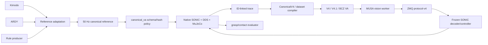

# Dependency map

## Directional ownership

| Boundary | Provider | Consumer | Contract |
|---|---|---|---|
| Motion generation → adaptation | Kimodo, ARDY, rule scripts | local adapters | source metadata, joint names, qpos/reference arrays; **no single shared Python protocol today** |
| Adaptation → canonical | `dl-group2` | `canonical_va.schema` | 50 Hz, 29/14 arrays, wxyz, world root, case/task arm, qualification metadata |
| Canonical → dataset | native replay/materializer | compiler and `CanonicalV4` | explicit observation/reference/token IDs and phase; no timestamp nearest-neighbor joins |
| Dataset → VA | `CanonicalV4` | V4 family trainers | RGB/state shapes, horizon targets, train-only normalization and provenance |
| VA → SONIC | `v4.sonic.ExternalTokenAdapter` | native SONIC | finite 64D float token, protocol version 4, execution index |
| SONIC → simulator | native controller/DDS | `TabletopDDS` bridge | LowCmd/LowState and original controller semantics |
| Simulator → evaluation | MuJoCo snapshot/evaluator | canonical/rollout reports | physics state, contacts, lift/hold/fall and timing evidence |

## Fragile coupling

* `canonical_va.runtime.py`, `native_replay.py`, rollout code and `grasp_pipeline` mutate `sys.path` to import `dl-group2/scripts` and SONIC (`runtime.py:7`; `v4/rollout.py:58-68`; `grasp_pipeline/*.py`). This is **VERIFIED** and makes package identity dependent on checkout layout.
* Runtime asset selection is duplicated: `canonical_va.common`, `dl-group2/scripts/project_paths.py`, `va_training` rollout and ARDY snapshots each locate SONIC/model/XML differently.
* The same semantic interfaces are reimplemented across `canonical_va.schema`, `dl-group2/scripts/episode_schema.py`, `grasp_pipeline/contracts.py`, and V4 dataset loaders. They are related validators, but not one versioned schema package.
* Native and synchronous policy helpers coexist. The synchronous path is explicitly non-production, but `canonical_va.policy` remains importable and `canonical_va.runtime` documents synchronous transport; callers can confuse audit helpers with native production.
* V4, V4.1, oracle, BCZ and older V2/V3 models share concepts while importing across package roots. The model/checkpoint family is encoded partly by directory and partly by checkpoint keys (`v4_1/model.py`, `v4_0_bcz_hand/model.py`), not by one registry.

## Cross-language and external edges

Native C++ embeds Python/MUSA ONNX (`musa_inference.hpp`), consumes release ONNX/YAML, publishes Unitree DDS, and is launched by Python PTY wrappers. CMake copies an instrumented native tree to `canonical_va/native_build`; the original SONIC checkout is intended to remain unchanged (`native_build.py:41-105`). ARDY and Kimodo depend on their own model checkpoints and text encoders. These external trees should remain separately versioned and referenced by immutable commit/hash manifests.

## Provenance gaps

The workspace root is not a Git repository. Several nested workspaces are unreadable to Git because of ownership. Large generated trees and untracked VA/canonical additions are therefore not reproducibly identified by commit alone. Hash manifests partially compensate for this, but source snapshots and checkpoints still need a first-class artifact registry.
