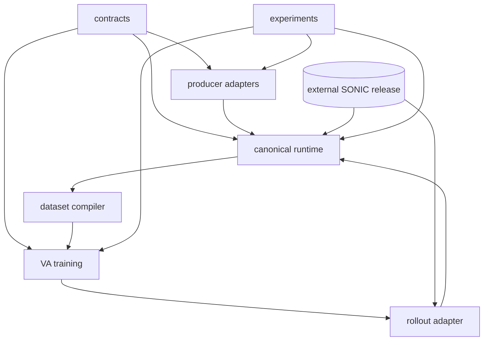

# Proposed target architecture

The safest target is a multi-repository architecture with a small, versioned contract package. A monorepo would simplify imports but would pull upstream SONIC, large model assets, generated data and experiment history into one high-risk change surface.

## Repository roles

1. **`sonic-upstream` (existing `GR00T-WholeBodyControl`).** Remains external and independently versioned. Preserve native controller, release ONNX, observation config, robot model and SDK. Local patches belong in a documented patch/build overlay, not upstream source edits.
2. **`va-contracts` (new small package extracted additively).** Owns versioned reference schema, joint orders, quaternion/units, case/task-arm profile, canonical sample IDs, model I/O contracts, runtime manifest and grasp criterion. It must have no MuJoCo, MUSA or DDS dependency.
3. **`motion-producers` (local adapters).** Kimodo and ARDY remain external dependencies; local adapters implement `ReferenceProducer` and `ReferenceAdapter` interfaces and emit immutable reference artifacts. Producer algorithms and checkpoints stay in their source repositories.
4. **`canonical-runtime` (current `canonical_va` + selected `dl-group2` bridge).** Owns native replay orchestration, MuJoCo scene bridge, EGL bootstrap, DDS namespace handling, trace materialization and forensic validation. It depends on `va-contracts` and a declared SONIC release manifest.
5. **`va-training` (current `va_training`).** Owns dataset loaders, model families, losses, trainers, offline metrics and model registry. Closed-loop runners depend on runtime adapters but training modules must not import DDS/MuJoCo.
6. **`experiments` (current `grasp_pipeline`, scripts and generated run metadata).** Owns CLI composition, experiment configs, immutable outputs, reports and promotion gates. It must call package APIs rather than mutate `sys.path`.

## Proposed tree

```text
workspace/
  contracts/                 # schemas, IDs, joint orders, profiles
  motion_producers/
    kimodo_adapter/
    ardy_adapter/
    rule_adapter/
  canonical_runtime/
    native_replay/
    mujoco_bridge/
    rendering/
    dataset_compiler/
    audit/
  va_training/
    models/{v2,v3,v4,v4_1,bcz_hand}/
    datasets/
    trainers/
    evaluation/
    rollout_adapters/
  experiments/
    cli/
    configs/
    reports/
  manifests/                 # release/runtime/source/checkpoint manifests
  artifacts/                 # generated, immutable, outside source packages
```

## Interfaces

`ReferenceProducer.generate(prompt, case, seed) -> ProducerReference` records source commit/checkpoint and native sample rate. `ReferenceAdapter.adapt(reference, case, task_arm) -> CanonicalReference` records resampling, joint permutation, frame transforms, IK/calibration and hashes. `ControllerBackend` has `NativeSonicBackend` and `SimulationBackend`; both consume the same `CanonicalReference` and emit `Trace` with explicit IDs. `DatasetCompiler` consumes only a validated `Trace`. `PolicyContract` declares input/output shapes and model family. `RolloutBackend` accepts `PolicyContract` outputs and reports scheduler/runtime/task gates separately.

The interfaces should be structural data contracts with validation, not a framework. Producer-specific math stays in adapters. SONIC remains behind a controller boundary. Training cannot import controller implementations.

## Dependency rules



No reverse dependency from contracts/runtime into training internals; no training import of `dl-group2/scripts`; no producer import of VA; no generated artifact imported as Python source.

## Promotion gates

Every artifact promotion records: source and checkpoint hashes, schema version, model family, runtime bundle, container/runtime identity, renderer identity, DDS namespace mode, scheduler counters, physical grasp criterion and separate pass/fail values for reference, dataset, offline, runtime and task gates.
